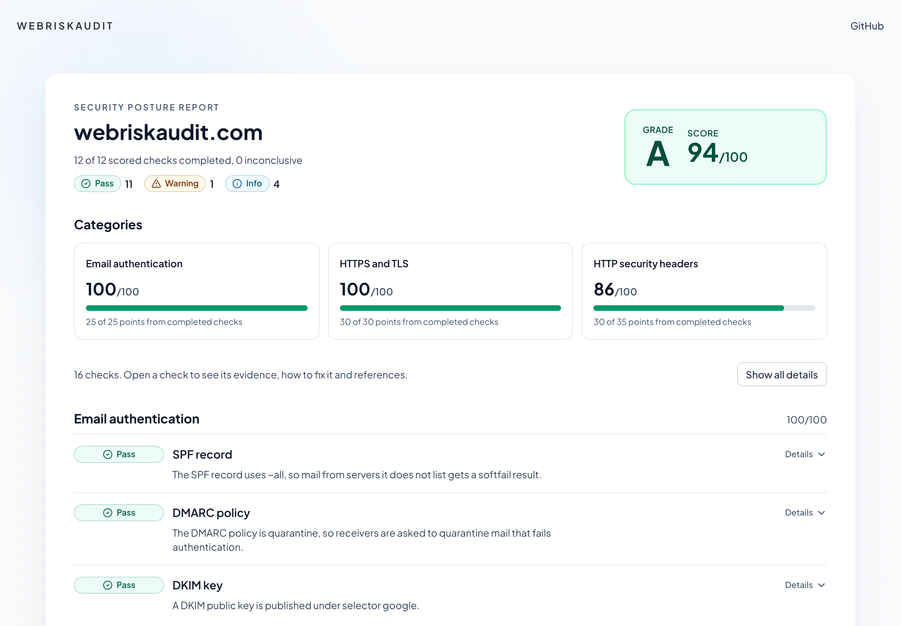
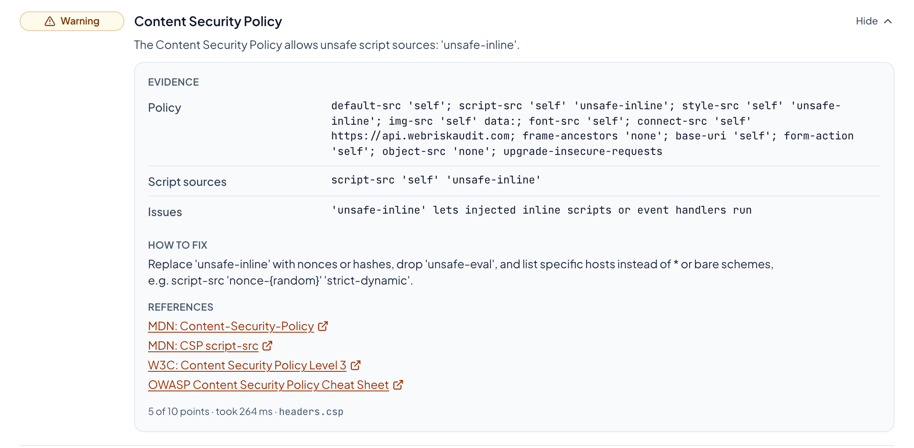
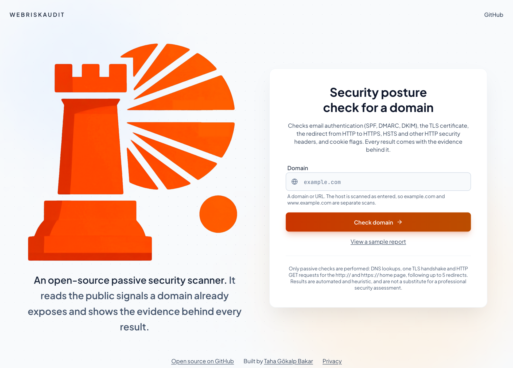
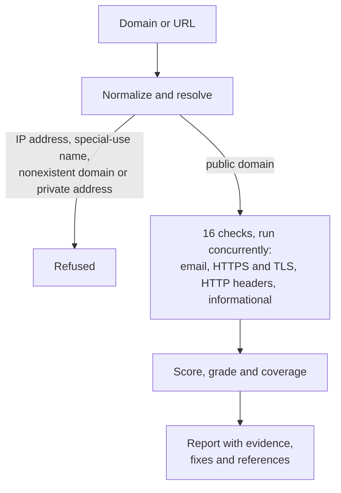
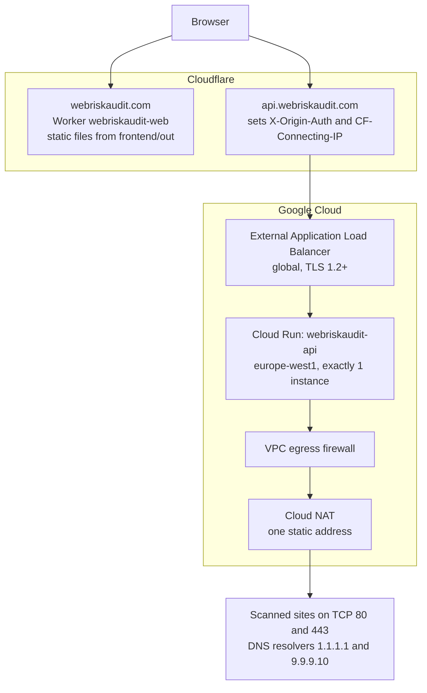

<div align="center">


# WebRiskAudit

**An open-source, passive security scanner for domains.**

Enter a domain and get a read on its email authentication, HTTPS and HTTP
security headers, scored out of 100, with an explanation of every verdict.

[**Scan a domain**](https://webriskaudit.com) ·
[Methodology](docs/METHODOLOGY.md) ·
[Threat model](docs/THREAT_MODEL.md) ·
[API](#api)

[](https://github.com/portakalp/webriskaudit/actions/workflows/ci.yml)
[](LICENSE)
[](backend/pyproject.toml)
[](frontend/package.json)

</div>

<p align="center">
  
</p>

## What it does

WebRiskAudit reads the public signals a domain already exposes and explains
them. It runs 16 checks, 12 of them scored. Those 12 are worth 90 points, and
the score out of 100 is the percentage earned:

| Category             | Points | What it looks at                                                                    |
| -------------------- | -----: | ----------------------------------------------------------------------------------- |
| Email authentication |     25 | SPF, DMARC and DKIM: can someone send mail that claims to come from this domain?    |
| HTTPS and TLS        |     30 | Certificate, the redirect from HTTP to HTTPS, and HSTS                              |
| HTTP security headers |    35 | Content Security Policy, clickjacking protection, referrer policy, cookie flags, and more |
| Informational        |      – | CDN, privacy policy link, Permissions-Policy, deprecated headers; never scored      |

Four ideas shape how it works:

- **Passive only.** A scan is DNS lookups, a TLS handshake to read the
  certificate and `GET` requests for the `http://` and `https://` home page,
  following up to 5 redirects. Nothing is exploited, brute forced or port
  scanned.
- **Every verdict explained.** Each result says what was found and shows the
  observed values where there are any. Every warning or failure says how to
  fix it, and every scored check links to the standard behind it.
- **Honest about what it doesn't know.** A check that can't reach a verdict is
  reported as inconclusive and left out of the score, instead of counting as
  a pass or a fail.
- **Nothing to sign up for.** No accounts, no database and no analytics. The
  logs keep the scanned domain and its result for 14 days, and the API never
  logs client IP addresses. Cloudflare, in front of it, does see them; the
  [privacy note](https://webriskaudit.com/privacy-policy) has the details.

## See it in action

Open a check to see its evidence, how to fix a problem and references. This
is the site's own report, including the one warning it still has:

<p align="center">
  
</p>

Try it at **[webriskaudit.com](https://webriskaudit.com)**. Only scan domains
you own or are authorised to assess.

<p align="center">
  
</p>

Or call the API directly:

```bash
curl -s -X POST https://api.webriskaudit.com/api/v1/scan \
  -H 'Content-Type: application/json' \
  -d '{"domain": "webriskaudit.com"}' | jq '{domain, score, grade, coverage}'
```

```json
{
  "domain": "webriskaudit.com",
  "score": 94,
  "grade": "A",
  "coverage": { "scored": 12, "inconclusive": 0, "total": 12 }
}
```

## How a scan works



Each check ends in one of five statuses:

| Status           | Points      | Meaning                                                                                                                                                                                        |
| ---------------- | ----------- | ---------------------------------------------------------------------------------------------------------------------------------------------------------------------------------------------- |
| **pass**         | full weight | The check's requirement is met                                                                                                                                                                 |
| **warn**         | half        | Present but weaker than recommended, not enforced (monitoring or testing mode), or not stated                                                                                                  |
| **fail**         | none        | Missing, invalid (ignored by receivers or browsers) or unsafe                                                                                                                                  |
| **inconclusive** | left out    | No verdict, for example: DNS did not answer, the server could not be reached or timed out, the home page was an error or bot-challenge page, the domain has no web server, or no DKIM key was found |
| **info**         | not scored  | Informational checks, which have no weight                                                                                                                                                     |

The score is the points earned divided by the weight of the scored checks that
reached a verdict, as a percentage; each category gets its own score the same
way. When those checks carry less than half of the 90 points, the report has
no score or grade, so a handful of passing checks cannot read as an A. The
report's `coverage` shows this: `scored` checks reached a verdict,
`inconclusive` ones did not, and `total` is all 12.

| Grade | A      | B     | C     | D     | F    |
| ----- | ------ | ----- | ----- | ----- | ---- |
| Score | 90-100 | 75-89 | 60-74 | 45-59 | 0-44 |

[docs/METHODOLOGY.md](docs/METHODOLOGY.md) explains every verdict rule.

<details>
<summary><strong>All 16 checks</strong></summary>

| ID                             | Check                                                                                                                            | Weight |
| ------------------------------ | -------------------------------------------------------------------------------------------------------------------------------- | -----: |
| `email.spf`                    | One valid SPF record (RFC 7208) ending in `-all` or `~all`, within 10 DNS-querying terms, without `ptr`                          |     10 |
| `email.dmarc`                  | DMARC policy (RFC 9989) of `quarantine` or `reject`, on the domain or inherited from a parent, not in testing mode               |     10 |
| `email.dkim`                   | A DKIM public key under one of 11 common selectors                                                                               |      5 |
| `transport.tls_certificate`    | The certificate on port 443 is trusted and matches the host, is not about to expire and its renewal is not overdue               |     15 |
| `transport.https_redirect`     | `http://` redirects straight to HTTPS (or port 80 is closed)                                                                     |      5 |
| `transport.hsts`               | `Strict-Transport-Security` with a `max-age` of at least 180 days                                                                |     10 |
| `headers.csp`                  | An enforced Content Security Policy that restricts scripts without `'unsafe-inline'`, `'unsafe-eval'`, wildcards or bare schemes |     10 |
| `headers.clickjacking`         | CSP `frame-ancestors`, or `X-Frame-Options: DENY` / `SAMEORIGIN`                                                                 |      5 |
| `headers.content_type_options` | `X-Content-Type-Options: nosniff`                                                                                                |      5 |
| `headers.referrer_policy`      | A stated `Referrer-Policy` of `no-referrer`, `same-origin`, `strict-origin` or `strict-origin-when-cross-origin`                 |      5 |
| `headers.cookies`              | Cookies set by the home page have `Secure` and `SameSite`, and session-like cookies `HttpOnly`                                   |      5 |
| `headers.server_disclosure`    | No version numbers in `Server`, `X-Powered-By`, `X-AspNet-Version` or `X-AspNetMvc-Version`                                      |      5 |
| `info.cdn`                     | CDN or edge network, recognized from response headers                                                                            |      0 |
| `info.privacy_policy`          | A privacy policy link on the home page (keywords in 17 languages)                                                                |      0 |
| `info.permissions_policy`      | Which browser features `Permissions-Policy` restricts                                                                            |      0 |
| `info.deprecated_headers`      | `X-XSS-Protection` (other than `0`), `Expect-CT`, `Public-Key-Pins` and `Public-Key-Pins-Report-Only`                            |      0 |

The scored checks add up to 90 points.

</details>

<details>
<summary><strong>Which domains are accepted</strong></summary>

Before any check runs, the input is normalized (a URL is reduced to its host;
`www.` is kept) and resolved. IP addresses, single-label and special-use
names (`localhost`, `.local`, `.internal`, `.invalid`, `.test`, `.onion`, ...)
are refused, and so are names that do not exist (NXDOMAIN) or resolve to a
non-public address. A domain without A/AAAA records is still scanned: the
email checks run and the web checks are inconclusive.

</details>

<details>
<summary><strong>Request footprint: exactly what a scan requests</strong></summary>

All checks are passive. A scan makes:

- **DNS lookups:** A and AAAA for the domain; TXT at the domain (SPF), at
  `_dmarc.<domain>` and, if nothing is there, at up to six parent names
  (DMARC); TXT at 11 `<selector>._domainkey.<domain>` names (DKIM); and A/AAAA
  again before every HTTP request and the TLS handshake.
- **One TLS handshake** on port 443 to read the certificate.
- **Two `GET` requests**, for `http://<domain>/` and `https://<domain>/`, each
  following up to 5 redirects. The HTTPS requests make their own handshakes.
  No other paths are requested, and at most 1 MB of each body is kept.

Requests only go to public IP addresses on the default ports, every redirect
is checked again before it is followed, and the User-Agent is
`WebRiskAudit/<version> (+https://github.com/portakalp/webriskaudit)`. A scan
typically takes a few seconds at most and is cut off after 45 seconds; when
the scanner is busy, a new scan may first wait up to 30 seconds for a free
slot.

</details>

## Engineering highlights

- **Rebuilt after finding real bugs in v1.** The rewrite fixed flaws such as a
  nonexistent domain scoring 75/100; [Project history](#project-history) has
  the details.
- **Protection against server-side request forgery (SSRF).** A scanner fetches
  URLs that strangers give it, so every hop, including each redirect, is checked before any connection:
  default ports only, no credentials in the URL, and every resolved address
  public. The request then goes to one of those resolved addresses, so a
  second DNS answer cannot redirect it.
  [The threat model](docs/THREAT_MODEL.md) covers this and the rest of the
  scanner's defences.
- **Abuse controls.** Per-client and global rate limits, one running scan per
  client, a bounded queue, a request size limit, a report cache and shared
  scans for concurrent requests.
- **Locked-down production.** Scans are accepted only through Cloudflare:
  requests straight to the load balancer get 403, except the public `GET /`
  and `GET /health`. An egress firewall limits what the scanner can reach. The
  API deploy uses Workload Identity Federation, so no Google Cloud key is
  stored in GitHub, and a failed API deploy or smoke test moves traffic back
  to the previous revision.
- **Infrastructure as code.** Terraform defines what runs in the Google Cloud
  project (network, firewall, load balancer, IAM and more), with tests against
  a mocked provider. [The runbook](docs/DEPLOYMENT.md) covers the steps done
  by hand: billing, the secret's value and the Cloudflare rules.
- **A typed contract.** The OpenAPI document is committed, the site's
  TypeScript types are generated from it, and CI fails when either drifts
  from the code.
- **Tests that never leave the machine.** Fakes stand in for DNS, HTTP and
  TLS, and sockets are disabled during the test run, except loopback for the
  tests that check SNI and certificate verification over real TLS.
- **Hardened CI.** `mypy --strict`, ruff, ESLint, Docker smoke tests,
  dependency audits and a secret scan on every change, with third-party
  actions pinned to commit SHAs.

### Tech stack

| Layer    | Tools                                                                       |
| -------- | --------------------------------------------------------------------------- |
| Backend  | Python 3.12, FastAPI, Pydantic, httpx, dnspython, uv, pytest, mypy, ruff    |
| Frontend | Next.js 16 (static export), React 19, TypeScript, Tailwind CSS 4, Vitest    |
| Platform | Cloud Run, Cloudflare Workers, Terraform, Docker, GitHub Actions            |

## Running locally

With Docker, `make up` (or `docker compose up --build`) builds both images and
starts the site on http://localhost:3000 and the API on
http://localhost:8000, bound to 127.0.0.1; `make down` stops them. `make help`
lists the other tasks (install, lint, typecheck, test, openapi, dev servers).

<details>
<summary><strong>Backend without Docker</strong> (Python 3.12, <a href="https://docs.astral.sh/uv/">uv</a>)</summary>

```bash
cd backend
uv sync
uv run uvicorn webriskaudit.api:app --reload --port 8000 --no-proxy-headers --ws none
```

`--no-proxy-headers` and `--ws none` match the Docker image: uvicorn trusts no
`X-Forwarded-For` header and has no WebSocket support. Interactive API docs are at
http://localhost:8000/docs unless `API_DOCS_ENABLED=false`. Settings are read
from environment variables, listed with their defaults in
[`backend/.env.example`](backend/.env.example). Certificates are verified
against the [certifi](https://pypi.org/project/certifi/) CA bundle, so no
system certificate setup is needed.

With the API running, scan a domain:

```bash
curl -s -X POST http://localhost:8000/api/v1/scan \
  -H 'Content-Type: application/json' \
  -d '{"domain": "example.com"}'
```

Tests and checks (the same as CI):

```bash
uv run pytest
uv run ruff check . && uv run ruff format --check .
uv run mypy
uv run python scripts/export_openapi.py   # regenerate openapi.json after API changes
```

</details>

<details>
<summary><strong>Frontend without Docker</strong> (Node.js 22, pnpm)</summary>

```bash
cd frontend
cp .env.example .env.local
pnpm install
pnpm dev
```

Then open http://localhost:3000. Without a running API the site shows an
error state and offers an example report with illustrative values.

Frontend checks (the same as CI):

```bash
pnpm lint
pnpm exec tsc --noEmit
pnpm test    # vitest
pnpm build   # static export into out/
```

The API's TypeScript types (`frontend/lib/api-types.ts`) are generated from
`backend/openapi.json`. After an API change, run `make openapi`, which runs
`scripts/export_openapi.py` in `backend/` and `pnpm gen:api` in `frontend/`.

</details>

### Repository layout

```
backend/      FastAPI service and the scanner package (src/webriskaudit)
frontend/     Next.js static site served at webriskaudit.com
docs/         Methodology, threat model, deployment runbook, decisions (docs/adr/)
infra/gcp/    Terraform for the API's Google Cloud project (docs/DEPLOYMENT.md)
deploy/       Cloud Run service spec, egress firewall check, post-deploy smoke tests
compose.yaml  Local Docker stack: the site and the API
Makefile      Common tasks; run "make" to list them
```

## API

| Method | Path           | Description                                         |
| ------ | -------------- | --------------------------------------------------- |
| `POST` | `/api/v1/scan` | Scan a domain and return the report                 |
| `GET`  | `/health`      | Liveness check                                      |
| `GET`  | `/`            | Service name, version, revision and docs path       |
| `GET`  | `/docs`        | Interactive docs; local only, off in production     |

The OpenAPI document is [`backend/openapi.json`](backend/openapi.json).

A report contains the domain, `scanned_at`, `duration_ms`, `score` and
`grade` (both `null` without enough coverage), `coverage`, per-category
scores, and one entry per check with its `status`, `points`, `summary`,
`evidence`, `remediation` and `references`. Evidence never includes cookie
values.

<details>
<summary><strong>Errors</strong></summary>

Errors are [RFC 9457](https://www.rfc-editor.org/rfc/rfc9457.html) problem
details (`application/problem+json`) with `type`, `title`, `status` and
`detail`. Problem types are `https://webriskaudit.com/problems/<slug>`:

| Status | Slug                | When                                                        |
| -----: | ------------------- | ----------------------------------------------------------- |
|    422 | `invalid-domain`    | The input is not a public domain name                       |
|    422 | `invalid-request`   | The body is not `{"domain": "<string>"}`                    |
|    422 | `domain-not-found`  | The domain does not exist (NXDOMAIN)                        |
|    422 | `non-public-target` | The domain resolves to a private or reserved address        |
|    400 | `invalid-client-ip` | No valid client address in the proxy's `CLIENT_IP_HEADER`   |
|    403 | `forbidden`         | The request did not come through the proxy (origin auth)    |
|    413 | `request-too-large` | The request body is larger than 8 kB                        |
|    429 | `rate-limited`      | Too many new scans; `Retry-After` gives the wait in seconds |
|    500 | `internal-error`    | Unexpected failure (no internal details are returned)       |
|    502 | `dns-unavailable`   | DNS gave no usable answer for the domain                    |
|    503 | `scanner-busy`      | No room for a new scan right now; see `Retry-After`         |

</details>

<details>
<summary><strong>Abuse controls, DNS and logging</strong></summary>

Abuse controls (defaults; set with the environment variables in
`backend/.env.example`): request bodies over 8 kB are refused; each client (an IPv4 address or an IPv6 /64 network) may
start 10 new scans per 10 minutes, one at a time, and all clients together 600;
a domain's report is cached for 10 minutes and cached reports do not count
against the limits; concurrent requests for the same domain share one scan; at
most 4 scans run at once and at most 16 more wait, each for up to 30 seconds,
after which the API answers 503; and a waiting scan is dropped when its client
disconnects. Every check reports at most 20 evidence items, so a hostile site
cannot inflate the report. The client is the TCP peer, or behind a proxy the
address in `CLIENT_IP_HEADER`, accepted only with origin authentication (see
[Deployment](#deployment)).

The scanner resolves names with the host's resolvers unless `DNS_NAMESERVERS`
lists others. On cloud hosts whose resolver also answers for private zones
(for example an AWS VPC with private hosted zones), set it to public
resolvers: otherwise the API's answers reveal which internal names exist, and
the email checks would show their TXT records.

The API keeps no database. It writes one JSON log line per
scan request (domain, outcome, cache use, score, grade, coverage, time spent
waiting and scanning, and whether the client address came from the proxy's
header or the TCP peer), a `startup` line with its settings (without
secrets), and tracebacks of unexpected errors. For an invalid body it logs
only the number and types of validation errors. It never logs client IP
addresses or request bodies, and switches off uvicorn's access log, which
would record client addresses. The image also turns off uvicorn's WebSocket
support, which would log the client address and path of every WebSocket
handshake. In production the logs are kept for 14 days, and unexpected
errors for up to 30 days in Error Reporting (see [Deployment](#deployment)).

</details>

## Deployment

The production setup is in this repository.
[docs/DEPLOYMENT.md](docs/DEPLOYMENT.md) is the runbook: the one-time setup
the owner does by hand, the first deploy and its checks, rollback, secret
rotation, monitoring and costs.



<details>
<summary><strong>How the pieces fit together</strong></summary>

- **Site** ([ADR 0008](docs/adr/0008-site-on-workers-static-assets.md)):
  Cloudflare Workers static assets serve the static export
  (`frontend/wrangler.jsonc`) with the headers from
  [`frontend/public/_headers`](frontend/public/_headers). No Worker script
  runs.
- **API** ([ADR 0007](docs/adr/0007-api-on-cloud-run.md)): Cloud Run with
  manual scaling of exactly one instance, because the rate limits, the
  queue and the cache live in memory. Ingress is limited to the load
  balancer and internal traffic, so the `run.app` URL is closed to the
  internet. All outbound traffic goes through a VPC whose egress firewall
  allows TCP 80 and 443 anywhere and DNS to the two resolvers only, and
  denies private and special-purpose ranges. Cloud NAT gives the scanner
  one fixed address ([SECURITY.md](SECURITY.md)).
- **Client address** ([ADR 0006](docs/adr/0006-client-ip-behind-cloudflare.md)):
  a Cloudflare Transform Rule sends a secret in `X-Origin-Auth`. The API
  answers 403 to any request without it, except `GET /` and `GET /health`,
  so the client address it reads from `CF-Connecting-IP` comes from
  Cloudflare. `X-Forwarded-For` is never read.
- **Configuration**: Terraform in `infra/gcp/` (network, firewall, NAT,
  load balancer, certificate, image registry, IAM, Workload Identity
  Federation, the secret without its value, logging, monitoring) and the
  service spec in `deploy/cloudrun/service.yaml`. The Cloudflare rules and
  the secret's value are set by hand, as the runbook describes.
- **Deploys**: after every CI job passes on `main`, the `deploy-api` job in
  `.github/workflows/ci.yml` signs in with Workload Identity Federation (no
  stored key), builds and pushes the image, deploys it by digest, runs
  `deploy/checks/api_smoke.sh`, and moves traffic back to the previous
  revision if the deploy or the smoke test fails. `deploy-site` then builds
  the site and runs `wrangler deploy` and `deploy/checks/site_smoke.sh`.
  Each job runs only when the repository variable `DEPLOY_API` or
  `DEPLOY_SITE` is `true`. `.github/workflows/rollback-api.yml` moves the
  API's traffic to a chosen revision.
- **Logs**: application logs go to a log bucket in europe-west1 and are
  kept for 14 days. Error Reporting can keep unexpected errors, which name
  the scanned domain, for up to 30 days. Cloud Run's request logs, which
  contain client addresses, are excluded, and the load balancer logs no
  requests.

</details>

<details>
<summary><strong>Production settings</strong></summary>

The API reads its settings from environment variables, listed with their
defaults in [`backend/.env.example`](backend/.env.example). Besides
`ALLOWED_ORIGINS=https://webriskaudit.com` and
`DNS_NAMESERVERS=1.1.1.1,9.9.9.10` (Quad9's `9.9.9.9` filters domains,
which then look nonexistent), production sets:

- `ORIGIN_AUTH_SECRETS`, from the Secret Manager secret
  `webriskaudit-origin-auth`: the accepted values of `X-Origin-Auth`,
  comma-separated so that an old and a new secret both work during a
  rotation, each at least 32 visible ASCII characters (for example from
  `openssl rand -hex 32`). When set, every route except `GET /` and
  `GET /health` answers 403 without one. Empty, the default, turns origin
  authentication off, as for local runs.
- `CLIENT_IP_HEADER=CF-Connecting-IP`: the header holding the client's
  address, the key of the rate limits. It must arrive once and hold one IP
  address, or the scan gets 400. It is required with `ORIGIN_AUTH_SECRETS`
  and refused without it; when both are empty, the client is the TCP peer.
- `API_DOCS_ENABLED=false`: no `/docs`, `/redoc` or `/openapi.json`
  (default `true`). The documentation pages load scripts from a CDN;
  [`backend/openapi.json`](backend/openapi.json) documents the API either
  way.

The rate limit, cache, queue and timeout settings keep their defaults.
Invalid values stop the API at startup, and the API logs its effective
settings, without secrets, in one `startup` line. `GET /` reports the
commit the image was built from as `revision`.

Two variables are read by the image's start command, not by the API:

- `PORT` (default 8000): the port uvicorn listens on and the image's Docker
  health check calls. Cloud Run sets it from the container port, 8000.
- `GRACEFUL_SHUTDOWN_SECONDS` (default 8): how long requests in flight may
  run after SIGTERM. Cloud Run stops the container 10 seconds after SIGTERM.

The site's API URL (`NEXT_PUBLIC_API_URL`) is inlined at build time, and the
site's Content Security Policy must allow its origin in `connect-src`, or
the browser blocks every scan. The deploy workflow builds the site with the
repository variable `NEXT_PUBLIC_API_URL` (`https://api.webriskaudit.com`),
the origin that [`frontend/public/_headers`](frontend/public/_headers)
allows, and refuses to deploy when they differ; change both together. The
Docker image fills in `connect-src` from its build argument.

</details>

## Known limitations

An automated, outside view has limits, and the report says so where it can.

- **DKIM selectors cannot be listed.** Only 11 common selectors are tried, so
  "no key found" is inconclusive, never a fail.
- **The DMARC tree walk is simplified.** It stops at the first name that
  publishes a record and does not apply RFC 9989's `psd=` rules for choosing
  the organizational domain.
- **SPF includes are not expanded.** The 10-lookup limit is counted on the
  top-level record only, so a record that exceeds it through nested
  `include:` terms is not flagged.
- **Headers come from the home page only.** Other pages are not fetched, and
  headers or cookies sent only on redirect responses are not seen, except
  HSTS: it is read from the scanned host's own HTTPS responses, redirects
  included, since a policy on `www.example.com` does not cover `example.com`.
  Links and meta tags added by JavaScript are not seen either.
- **One vantage point.** Results show what the scanner's network sees; a web
  application firewall (WAF) that blocks it makes the header checks
  inconclusive. Connections go to the
  first IPv4 address (IPv6 only if there is none), and failed connections to
  IPv6-only hosts are inconclusive, since the scanner may lack IPv6.
- **TLS is checked through one handshake.** Trust, host name, expiry and the
  negotiated protocol are checked; cipher suites and other protocol versions
  are not enumerated. A server that only offers TLS 1.0 or 1.1 fails the
  handshake and the check.
- **Abuse controls are per process.** The rate limit and report cache live in
  memory, so they reset on every restart and deploy and are not shared
  between processes. Production runs one process on one instance.

## Roadmap

- A hash-based Content Security Policy for the site, without
  `'unsafe-inline'` in `script-src`
- Narrow the known limitations where it can be done passively, starting with
  expanding SPF includes to count nested lookups

## Project history

v1 (December 2025 to June 2026) was the MVP of a small security-audit service:
visitors entered an email address and a domain, got a short report, and were
offered paid audit packages. I no longer offer that service, so v2 removes the
lead capture, pricing, booking and analytics, and turns the scanner into a
non-commercial, open-source tool.

Rebuilding it also exposed flaws in the v1 scanner, which v2 fixes with
tests:

- Errors counted as passes ("benefit of the doubt"), so a domain that does
  not exist scored 75/100. v2 refuses such domains and reports checks that
  cannot reach a verdict as inconclusive.
- DMARC was parsed by substring matching, so `p=none; sp=reject` read as
  `p=reject`.
- The DNS blocklist check could not report a listing, because an attribute
  error was swallowed as "clean". v2 drops the check, and no longer scores
  the mere presence of a CDN or WAF.
- The API fetched whatever host it was given and followed redirects without
  checking them, with no protection against server-side request forgery.

The final v1 code is tagged [`v1.0.0`](../../tree/v1.0.0). Its earlier history
was not imported because it contained a hardcoded credential.

## Documentation

| Document                                 | What it covers                                               |
| ---------------------------------------- | ------------------------------------------------------------ |
| [Methodology](docs/METHODOLOGY.md)       | Every verdict rule, and how scores are calculated            |
| [Threat model](docs/THREAT_MODEL.md)     | How the scanner protects itself and the sites it scans       |
| [Deployment runbook](docs/DEPLOYMENT.md) | Setup, first deploy, rollback, rotation, monitoring, costs   |
| [Decision records](docs/adr/)            | Why the main technical decisions were made                   |
| [Security policy](SECURITY.md)           | Reporting a vulnerability, responsible use, scanner traffic  |

## Security

See [SECURITY.md](SECURITY.md) for how to report a vulnerability and for the
responsible-use policy. Only scan domains you own or are authorised to assess.

## License

[MIT](LICENSE) © Taha Gökalp Bakar
