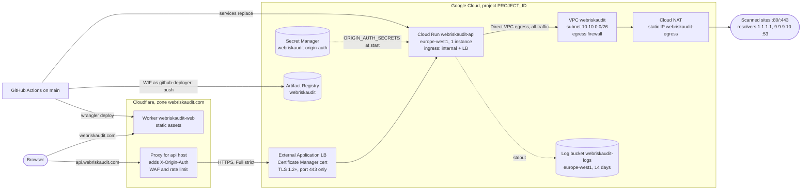

# Deployment

How webriskaudit.com and api.webriskaudit.com are hosted, how to set them up
from nothing, and how to operate them. The reasons are in
[ADR 0007](adr/0007-api-on-cloud-run.md) (API) and
[ADR 0008](adr/0008-site-on-workers-static-assets.md) (site).

The setup steps need accounts, payment details or dashboards, so the owner
does them by hand, in the order given. Points marked **Unverified** come
from documentation or reasoning but have not been tested on this setup yet;
check them during the first deploy and update this file.

Run every command from the repository root. Terraform commands use
`-chdir=infra/gcp`, so no step changes directory.

Status: not live yet. Cutover date: _(fill in)_.

## Architecture



What lives where:

| Part | Where it is defined |
|---|---|
| Project resources: APIs, network, firewall, NAT, load balancer, certificate, IAM, WIF, secret (without value), logging, monitoring | `infra/gcp/` (Terraform, applied by hand) |
| Cloud Run service spec (image, scaling, VPC, env, probes) | `deploy/cloudrun/service.yaml` (applied by the deploy workflow) |
| Egress firewall proof | `deploy/checks/egress_check.py`, `deploy/cloudrun/egress-check-job.yaml` |
| Site Worker (static assets on the `webriskaudit.com` custom domain) | `frontend/wrangler.jsonc` (applied by `wrangler deploy`) |
| Builds, deploys, rollback workflow | `.github/workflows/ci.yml` (`deploy-api`, `deploy-site`), `.github/workflows/rollback-api.yml` |
| Post-deploy smoke tests | `deploy/checks/api_smoke.sh`, `deploy/checks/site_smoke.sh` |
| Billing, budget, state bucket, secret value, Cloudflare rules, GitHub settings | By hand, this file |

## Names

| Thing | Name |
|---|---|
| Region | `europe-west1` |
| Cloud Run service | `webriskaudit-api` |
| Artifact Registry repository | `webriskaudit` (`europe-west1-docker.pkg.dev/PROJECT_ID/webriskaudit`) |
| Service accounts | `api-runtime` (runs the API), `github-deployer` (CI) |
| Workload identity pool / provider | `github` / `webriskaudit` |
| VPC / subnet / network tag | `webriskaudit` / `webriskaudit-euw1` (`10.10.0.0/26`) / `webriskaudit-api` |
| Firewall rules | `webriskaudit-egress-{deny-special-ranges,allow-web,allow-dns-resolvers,deny-all}` |
| Router / NAT / NAT address | `webriskaudit-router` / `webriskaudit-nat` / `webriskaudit-egress` |
| Load balancer address, backend, URL map, proxy, certificate | `webriskaudit-api` |
| Forwarding rule | `webriskaudit-api-https` |
| Secret | `webriskaudit-origin-auth` |
| Log bucket and sink | `webriskaudit-logs` |
| Worker (site) | `webriskaudit-web` |
| GitHub environment | `production` |
| Repository variables | `DEPLOY_API`, `DEPLOY_SITE`, `GCP_PROJECT_ID`, `GCP_WIF_PROVIDER`, `GCP_DEPLOYER_SA`, `API_LB_IP`, `NEXT_PUBLIC_API_URL`, `CLOUDFLARE_ACCOUNT_ID` |
| Repository secret | `CLOUDFLARE_API_TOKEN` |

## Setup (Owner, in this order)

### 1. Repository visibility and GitHub settings

Do this first if the repository is going public before launch.

1. Scan the whole history locally: `gitleaks git --log-opts=--all .` (the
   same tool as the CI `secrets` job). Check that old Actions logs show no
   secrets; they become public too.
2. Settings → General → Danger Zone → **Change visibility → Public**.
3. Settings → Actions → General: fork pull request workflows from outside
   collaborators → **Require approval for all outside collaborators**;
   Workflow permissions → **Read repository contents**.
4. Settings → Rules → Rulesets → **New branch ruleset**: name `main`,
   enforcement **Active**, target **Include default branch**. Turn on
   **Restrict deletions**, **Block force pushes**, **Require a pull request
   before merging** (no required approvals; you are the only maintainer)
   and **Require status checks to pass** with the CI jobs `Frontend (lint,
   types, tests, build)`, `Backend (lint, types, tests, OpenAPI)`, `Docker
   images (build, smoke test)`, `Dependency audit`, `Terraform (format,
   validate, test)` and `Secret scan`. Leave the bypass list empty.
   Workload Identity Federation trusts the deploy workflows on `main`, so
   nothing should reach `main` without review and CI.
5. Settings → Environments → **New environment** `production` →
   Deployment branches → **Selected branches** → `main`. Add no reviewers,
   or automatic deploys wait for approval.
6. Settings → Advanced Security → **Private vulnerability reporting →
   Enable**. It is off by default, and [SECURITY.md](../SECURITY.md) sends
   reporters to it.

On GitHub Free, rulesets and environments only work in public
repositories. If the repository stays private, skip steps 4 and 5, keep
`github_require_environment = false` in Terraform, and the deploy jobs must
not use `environment:`.

### 2. Google Cloud account, billing and project

1. Turn on 2-Step Verification for the Google account.
2. console.cloud.google.com → Billing → **Create account**. Choose the
   account type that matches your tax status: **it cannot be changed
   later**. For an individual without a VAT number this is probably the type
   where Google adds VAT; the "Business" type uses reverse charge. Check
   [Google's VAT page](https://docs.cloud.google.com/billing/docs/resources/vat-overview)
   first; this is not tax advice.
3. **Create project**, ID for example `webriskaudit-prod`, and link it to
   the billing account.
4. Billing → **Budgets & alerts** → Create: this project, USD 50 a month,
   thresholds 50 %, 90 %, 100 % and forecast, email to you. Optionally a
   Cloud Run spend cap (when reached, the API returns errors).

### 3. Local tools and the state bucket

```bash
brew install --cask google-cloud-sdk
brew install hashicorp/tap/terraform        # 1.16 or later
gcloud auth login
gcloud config set project PROJECT_ID
# Credentials for Terraform (Application Default Credentials), with this
# project as the quota project.
gcloud auth application-default login
gcloud auth application-default set-quota-project PROJECT_ID

gcloud storage buckets create gs://PROJECT_ID-tfstate --location=europe-west1 \
  --uniform-bucket-level-access --public-access-prevention
gcloud storage buckets update gs://PROJECT_ID-tfstate --versioning
```

Terraform calls Google APIs with your user credentials, and with user
credentials some APIs, such as Service Usage (which enables the other APIs
in step 4), refuse requests without a quota project. The ADC login takes
the quota project from the gcloud configuration, so the project is set
first; `set-quota-project` makes sure.

The state holds resource attributes but no secret values (the origin
secret's value never goes through Terraform).

### 4. Terraform

```bash
cp infra/gcp/terraform.tfvars.example infra/gcp/terraform.tfvars   # set project_id and alert_email
terraform -chdir=infra/gcp init -backend-config="bucket=PROJECT_ID-tfstate"

# Enable the APIs first; resources created right after an API is switched on
# sometimes fail. If a later apply still fails that way, run it again.
terraform -chdir=infra/gcp apply -target=google_project_service.enabled
terraform -chdir=infra/gcp plan     # about 40 more resources, all in this project
terraform -chdir=infra/gcp apply
terraform -chdir=infra/gcp output
```

Note `lb_ip`, `nat_ip`, `wif_provider`, `deployer_sa` and
`dns_authorization_record`.

The API's uptime check runs from now on, but its alert stays off
(`api_alert_enabled = false`): until the first deploy only the placeholder
service answers, so the check fails. Checklist step 10 turns the alert on.

Things Terraform does not do here, with the command instead:

- **The default network.** Enabling the Compute Engine API creates a
  `default` network with permissive firewall rules. Nothing uses it; delete
  it:
  ```bash
  for rule in $(gcloud compute firewall-rules list --filter="network:default" --format="value(name)"); do
    gcloud compute firewall-rules delete "$rule" --quiet
  done
  gcloud compute networks delete default --quiet
  ```
- **Budget**: set in the console (step 2).
- **The origin secret's value** (step 5).
- **The `_Default` log sink** is taken over and disabled by Terraform
  (`google_logging_project_sink.default`). `terraform destroy` leaves it
  disabled; switch it back on with
  `gcloud logging sinks update _Default --no-disabled`.

### 5. Origin secret

```bash
SECRET=$(openssl rand -hex 32)
printf %s "$SECRET" | gcloud secrets versions add webriskaudit-origin-auth --data-file=-
```

Save the value in your password manager (needed in step 6f), then
`unset SECRET`. It must not end up in the repository, the Terraform state or
a chat.

### 6. Cloudflare (dashboard, zone webriskaudit.com)

a. **Inventory, no changes yet.** Note the SSL/TLS mode and HSTS
   (Edge Certificates); every rule under Rules (Transform, Configuration,
   Cache, Redirect, Page Rules) and Managed Transforms; Bot Fight Mode,
   Rocket Loader, Speed Brain, Zaraz, Web Analytics/RUM, Email Obfuscation;
   export the DNS zone file and check whether a `www` record exists; in
   Workers & Pages, the old Pages project's name, custom domains and
   environment variables (if the old HIBP key is there, revoke it at HIBP).

b. **DNS authorization record.** DNS → Add record, from
   `terraform -chdir=infra/gcp output dns_authorization_record`: type
   `CNAME`, name `_acme-challenge.api` (Cloudflare adds the zone), target
   the `data` value, Proxy status **DNS only**.

c. **Wait for the certificate** (minutes to hours):
   ```bash
   gcloud certificate-manager certificates describe webriskaudit-api \
     --location=global --format="value(managed.state)"     # ACTIVE
   ```
   If it stays `PROVISIONING`, check `managed.authorizationAttemptInfo` in
   the full output.

d. **API record.** DNS → Add record: type `A`, name `api`, IPv4 `lb_ip`,
   **Proxied**. No AAAA record; Cloudflare serves IPv6 visitors itself.
   Until the first deploy the placeholder "hello" page answers.

e. **TLS to the origin.** Rules → Configuration Rules → Create:
   `Hostname equals api.webriskaudit.com` → SSL **Strict** (Full
   (strict)). Also make sure SSL/TLS → Edge Certificates → **Always Use
   HTTPS** is on: the load balancer has no port 80 listener, so a plain
   HTTP request that reached it would fail. Do not turn on Under Attack
   mode or a high Security Level for this host; API calls cannot solve
   challenges.

f. **Origin header.** Rules → Transform Rules → **Modify Request Header**
   → Create: `Hostname equals api.webriskaudit.com` → **Set static**,
   header `X-Origin-Auth`, value from step 5.

g. **Cache.** Rules → Cache Rules → Create:
   `Hostname equals api.webriskaudit.com` → **Bypass cache**.

h. **Methods.** Security → WAF → Custom rules → Create, action **Block**:
   ```
   (http.host eq "api.webriskaudit.com" and not http.request.method in {"GET" "HEAD" "POST" "OPTIONS"})
   ```

i. **Rate limit** (the Free plan allows one rule, path only, IP-based,
   10-second period and 10-second block). Security → WAF → Rate limiting
   rules → Create: `URI Path equals /api/v1/scan`, 10 requests per 10
   seconds per IP → **Block** for 10 seconds. It also counts CORS preflight
   requests, so one scan from a browser counts twice. The API's own limits
   (10 scans per 10 minutes per client) are the real control.

j. **Bot Fight Mode: Off** (Security → Bots, whole zone). It can challenge
   API calls, cannot be skipped by a WAF rule, and sets the `__cf_bm`
   cookie, which contradicts the privacy note's "no cookies".

k. **Client address.** Network → **Pseudo IPv4: Off** (its "Overwrite
   Headers" mode replaces IPv6 addresses in `CF-Connecting-IP` and breaks
   the per-/64 limit). Rules → Managed Transforms → **Remove visitor IP
   headers: Off**. Leave "Add security headers" for the cutover.

l. **API token for the site deploy.** Manage Account → **Account API
   Tokens** → Create → Custom: permission **Account › Workers Scripts ›
   Edit**, this account only, TTL one year. Copy the token. Copy the
   Account ID from the Workers & Pages overview. If the account has no
   `workers.dev` subdomain yet, choose one in Workers & Pages.
   **Unverified:** whether `wrangler deploy` needs any permission beyond
   Workers Scripts: Edit (for example to read the `workers.dev` subdomain).
   The custom domain is added in the dashboard at cutover, not by the token.

Each rule can be disabled with one click. Deleting the `api` record takes
the API off the internet entirely.

### 7. GitHub variables and secret

Variables at repository level (the deploy jobs read them in or outside the
environment):

```bash
gh variable set GCP_PROJECT_ID        --body PROJECT_ID
gh variable set GCP_WIF_PROVIDER      --body "$(terraform -chdir=infra/gcp output -raw wif_provider)"
gh variable set GCP_DEPLOYER_SA       --body "$(terraform -chdir=infra/gcp output -raw deployer_sa)"
gh variable set API_LB_IP             --body "$(terraform -chdir=infra/gcp output -raw lb_ip)"
gh variable set NEXT_PUBLIC_API_URL   --body https://api.webriskaudit.com
gh variable set CLOUDFLARE_ACCOUNT_ID --body ACCOUNT_ID
gh variable set DEPLOY_API  --body false
gh variable set DEPLOY_SITE --body false

gh secret set CLOUDFLARE_API_TOKEN --env production   # prompts for the value
# Private repository (no environments): gh secret set CLOUDFLARE_API_TOKEN
```

Workload Identity Federation accepts only `push` and `workflow_dispatch`
runs on `main` of the workflow files in `github_deploy_workflows`
(`ci.yml` and `rollback-api.yml`). A new or renamed deploy workflow must be
added there, and applied, before it can authenticate.

The deploy jobs and the rollback workflow run in the `production`
environment, so also require it in Workload Identity Federation: set
`github_require_environment = true` in `infra/gcp/terraform.tfvars` and run
`terraform -chdir=infra/gcp apply`. Tokens from jobs outside that
environment are then refused. If the repository stays private on GitHub
Free, delete the `environment:` blocks of `deploy-api` and `deploy-site` in
`ci.yml` and of `rollback` in `rollback-api.yml` instead, keep
`github_require_environment = false`, and set `CLOUDFLARE_API_TOKEN` as a
repository secret.

Each deploy job starts by checking the variables it needs and stops with an
error naming the one that is missing or malformed. Unless `DEPLOY_API` or
`DEPLOY_SITE` is `true` (GitHub compares without case), its job is skipped;
with both unset or `false`, CI deploys nothing.

## First deploy and verification

### API

```bash
gh variable set DEPLOY_API --body true
gh workflow run ci.yml --ref main
gh run watch
```

Expected: the CI jobs, then `deploy-api`: build and push
`europe-west1-docker.pkg.dev/PROJECT_ID/webriskaudit/api:COMMIT`, note the
revision that serves now, replace the service with the image's digest (the
first start can take 30 to 120 seconds because of Direct VPC egress), then
`deploy/checks/api_smoke.sh`:

- `GET /` reports the new commit as `revision` (retried for up to 6
  minutes) and `docs` is `null`; `GET /health` is `ok`;
- a CORS preflight from https://webriskaudit.com is allowed, one from
  another origin is not;
- one scan of webriskaudit.com returns a score, with the TLS certificate
  and HTTPS redirect checks completed (outbound 443 and 80 through NAT);
- a scan of `localhost` gets 422 `invalid-domain`;
- the same scan sent straight to `API_LB_IP`, without Cloudflare's
  `X-Origin-Auth`, gets 403 `forbidden`.

A 429 (the API's or Cloudflare's rate limit; runners share addresses) is
retried once after `Retry-After`. If any step from the deploy on fails, or
the job is cancelled or times out after the deploy began, the job moves all
traffic back to the noted revision and waits up to 4 minutes for `/health`
to answer with any 2xx status. On the first deploy that revision is the
placeholder, which answers every path, `/health` included, with its hello
page; that is fine. The deploy step may take 10 minutes and the smoke test
20; past that they fail, so the rollback runs well within the job's
50-minute limit. After a cancel GitHub gives the job about 5 more minutes:
enough to move the traffic, though the `/health` wait may be cut short. The
job summary lists the new and the previous revision.

Logs: Logs Explorer → Refine scope → **Log view** →
`webriskaudit-logs/_AllLogs`, or

```bash
gcloud logging read 'resource.type="cloud_run_revision"' \
  --bucket=webriskaudit-logs --location=europe-west1 --view=_AllLogs \
  --freshness=1h --limit=100
```

**Unverified:** whether `gcloud run services logs read` and the default
Logs Explorer scope show entries that are stored only in the regional
bucket.

### Checklist (from your laptop; scan only your own domain)

1. `curl -sS https://api.webriskaudit.com/ | jq` shows the latest commit as
   `revision`.
2. `curl -sSI https://api.webriskaudit.com/health`: `server: cloudflare`, no
   `set-cookie`, `cf-cache-status` absent or `DYNAMIC`.
3. **No bypass.**
   ```bash
   curl -s -o /dev/null -w '%{http_code}\n' \
     --resolve "api.webriskaudit.com:443:$(terraform -chdir=infra/gcp output -raw lb_ip)" \
     -X POST https://api.webriskaudit.com/api/v1/scan \
     -H 'Content-Type: application/json' -d '{"domain":"webriskaudit.com"}'      # 403
   curl -s -o /dev/null -w '%{http_code}\n' \
     "$(gcloud run services describe webriskaudit-api --region europe-west1 --format='value(status.url)')/health"
   # an error status (403 or 404), never 200
   ```
4. **Scan** webriskaudit.com in the browser or with curl. DNS results
   without `dns-unavailable` show that port 53 to the resolvers works
   through NAT.
5. **Rate limit and spoofing.** Each request uses a new, non-existent
   subdomain, so nothing is cached and every request counts; `sleep 2`
   keeps under the Cloudflare rule.
   ```bash
   API=https://api.webriskaudit.com; T=$(date +%s)
   for i in $(seq 1 11); do
     curl -s -o /dev/null -w "$i %{http_code}\n" -X POST "$API/api/v1/scan" \
       -H 'Content-Type: application/json' \
       -H "X-Forwarded-For: 198.51.100.$i" -H "CF-Connecting-IP: 198.51.100.$i" \
       -H "True-Client-IP: 198.51.100.$i" -H "X-Real-IP: 198.51.100.$i" \
       -d "{\"domain\":\"rl-test-$T-$i.webriskaudit.com\"}"
     sleep 2
   done
   ```
   Expected: requests 1 to 10 are not 429, request 11 is 429 with
   `Retry-After`. (Cloudflare rejecting the forged `CF-Connecting-IP` is
   also a pass.) Then one scan from a phone hotspot must not get 429.
6. **Egress address.** `terraform -chdir=infra/gcp output -raw nat_ip` is
   the address the scanner uses; the egress check job (step 9) confirms it
   from inside. Alternatively switch NAT logging on briefly, run a scan,
   look for `resource.type="nat_gateway"` in the log bucket, and switch it
   back (NAT logs contain the scanned addresses):
   ```bash
   gcloud compute routers nats update webriskaudit-nat --router=webriskaudit-router \
     --region=europe-west1 --enable-logging --log-filter=ALL
   # ... scan, check ...
   gcloud compute routers nats update webriskaudit-nat --router=webriskaudit-router \
     --region=europe-west1 --enable-logging --log-filter=ERRORS_ONLY
   ```
7. **Logs.** In the log bucket, `jsonPayload.message="scan"` entries have
   their fields and a `severity`, and no client address.
   `LOG_ID("run.googleapis.com/requests")` returns nothing. The bucket's
   location is `europe-west1`:
   `gcloud logging buckets describe webriskaudit-logs --location=europe-west1`.
8. **No drift.** `terraform -chdir=infra/gcp plan` reports no changes after
   the deploy (the service is `ignore_changes = all`).
9. **Egress firewall proof.** Runs the check script inside the VPC with
   the API's tag and service account:
   ```bash
   PROJECT_ID=$(gcloud config get-value project)
   NAT_IP=$(terraform -chdir=infra/gcp output -raw nat_ip)
   IMAGE=$(gcloud run services describe webriskaudit-api --region europe-west1 \
     --format='value(spec.template.spec.containers[0].image)')
   JOB_YAML=$(mktemp)
   sed -e "s|__PROJECT__|$PROJECT_ID|" -e "s|__IMAGE__|$IMAGE|" -e "s|__NAT_IP__|$NAT_IP|" \
       -e "s|__SCRIPT_B64__|$(base64 < deploy/checks/egress_check.py | tr -d '\n')|" \
       deploy/cloudrun/egress-check-job.yaml > "$JOB_YAML"
   gcloud run jobs replace "$JOB_YAML" --region europe-west1
   gcloud run jobs execute webriskaudit-egress-check --region europe-west1 --wait
   gcloud logging read 'resource.type="cloud_run_job" AND resource.labels.job_name="webriskaudit-egress-check"' \
     --bucket=webriskaudit-logs --location=europe-west1 --view=_AllLogs --freshness=1h \
     --format='value(jsonPayload)'
   gcloud run jobs delete webriskaudit-egress-check --region europe-west1 --quiet
   ```
   Every line should have `"ok": true` and the summary `"failed": 0`:
   DNS over UDP and TCP to `1.1.1.1` and `9.9.9.10` allowed; to `8.8.8.8`
   blocked; webriskaudit.com on 80 and 443 allowed and on 8443 blocked
   (Cloudflare listens there, so this proves the final deny rule); no IPv6
   connection (`ipv6`, to `1.1.1.1`'s IPv6 address on 443); the private
   addresses unreachable (`private`); the metadata server either blocked or
   refusing a request without `Metadata-Flavor`; the egress address equal
   to `nat_ip`. Record the metadata result in the threat model: if it is
   reachable, a request with the header gets a token for `api-runtime`,
   which has no roles beyond reading the origin secret.

   The `private` lines do not prove the priority-900 deny rule: nothing in
   the VPC uses those addresses and the default internet gateway does not
   deliver to them, so they would be dropped without the rule too, and VPC
   firewall rules logging, which could show the rule matching, is not
   available for Direct VPC egress. That the rule exists as written is
   shown by step 8 (no drift) and by `terraform test` in CI.
10. **API alert.** Monitoring → Uptime checks → `WebRiskAudit API /health`
    passes from all three locations (it needs `{"status":"ok"}`, which the
    placeholder does not serve). Then set `api_alert_enabled = true` in
    `infra/gcp/terraform.tfvars` and run `terraform -chdir=infra/gcp apply`;
    the plan changes only that alert policy.

### Site on workers.dev

Before the cutover only. Since v2.0.0 `wrangler.jsonc` has `workers_dev:
false`, the site lives only on `webriskaudit.com`, and the smoke test runs
against that domain.

```bash
gh variable set DEPLOY_SITE --body true
gh workflow run ci.yml --ref main
```

`deploy-site` runs after `deploy-api` (also when that job was skipped). It
builds the site with `NEXT_PUBLIC_API_URL`, refuses to deploy if the build
does not contain that URL or `frontend/public/_headers` does not allow it in
`connect-src`, runs `wrangler deploy` in `frontend/` (the Worker is created
on the first deploy), and then runs `deploy/checks/site_smoke.sh` against
the `workers.dev` URL that wrangler reports.

The smoke test checks what to look for by hand on
`https://webriskaudit-web.SUBDOMAIN.workers.dev`: `/` and `/privacy-policy`
load with exactly one `content-security-policy` (with the API origin),
`x-frame-options: DENY`, `x-content-type-options: nosniff`,
`referrer-policy: strict-origin-when-cross-origin`, no
`access-control-allow-origin: *` and no Google Tag Manager; a
`/_next/static/` file is cached as immutable; an unknown path gets the 404
page with status 404. Scans fail there (CORS allows only
https://webriskaudit.com); that is expected.

## Cutover of webriskaudit.com

Before: the checks above pass, the privacy note for the new hosting is on
`main` and visible on workers.dev, and the old Pages project's automatic
production and preview deployments are off. In one session at a quiet hour
(30 to 60 minutes):

1. **Remove the old dashboard header rules.** Rules → Transform Rules →
   Modify Response Header: **disable** (do not delete yet) the CSP and
   Permissions-Policy rules. Their `connect-src` points at the old API, so
   the browser would block every scan.
2. Rules → Managed Transforms → **Add security headers: Off** (it overrides
   the site's `X-Frame-Options` and `Referrer-Policy` and adds `Expect-CT`
   and `X-XSS-Protection`).
3. Turn off everything that injects scripts: Rocket Loader, Zaraz, Web
   Analytics automatic setup/RUM, Email Obfuscation.
4. Old Pages project → Custom domains: delete the apex CNAME in DNS first,
   then remove the `webriskaudit.com` custom domain (and `www`). A Worker
   custom domain cannot be created over an existing CNAME.
5. Run `wrangler deploy` in `frontend/`. The custom domain route in
   `wrangler.jsonc` creates the `webriskaudit.com` DNS record and its
   certificate. While the hostname still has another DNS record, it fails
   with code 100117 ("already has externally managed DNS records"); delete
   that record (step 4) and run it again. If `www` exists, keep it proxied
   and add a Redirect Rule `www` → apex (301).
6. Verify:
   ```bash
   curl -sI https://webriskaudit.com
   curl -sI https://webriskaudit.com/privacy-policy
   curl -sI http://webriskaudit.com            # 301 to https
   ```
   One complete `content-security-policy` with
   `connect-src 'self' https://api.webriskaudit.com`; `x-frame-options:
   DENY`; `referrer-policy: strict-origin-when-cross-origin`; no
   `expect-ct`, no `access-control-allow-origin: *`, no `googletagmanager`;
   `/_next/static/*` with an immutable cache header. A real scan in the
   browser shows no CSP errors in the console. **Unverified:** whether the
   zone's HSTS and the site's `_headers` produce two HSTS headers (harmless,
   but note it).
7. Merge the follow-up that sets `workers_dev: false`, points the site
   smoke test at `https://webriskaudit.com`, and removes the README's
   pre-launch status note. Then run `wrangler deploy` again, so the
   `workers.dev` copy goes away.

Cutover rollback (if not fixed within 15 minutes): remove the Worker's
custom domain; delete the Advanced Certificate it created, if any (it is
not removed automatically and conflicts with Pages); add `webriskaudit.com`
back to the old Pages project; re-enable the Transform Rule and the Managed
Transform.

Clean-up: after a week, delete the disabled response header rules; after
two to four weeks, delete the old Pages project and remove the Cloudflare
Pages GitHub app's access to the old repository (which stays private and
archived: its history contains an old key).

## Rollback

API, to an earlier revision:

```bash
gcloud run revisions list --service webriskaudit-api --region europe-west1
gcloud run services update-traffic webriskaudit-api --region europe-west1 \
  --to-revisions=REVISION=100
```

The rollback workflow does the same through Workload Identity Federation,
and then waits for `/health`:

```bash
gh workflow run rollback-api.yml --ref main -f revision=REVISION
```

It shares a concurrency group with the deploy job, so a rollback waits for
a running deploy and the other way round. The group never cancels a
running deploy or rollback, but GitHub keeps only one waiting in it: when
another is queued, the waiting one is cancelled. If that drops a deploy
(`deploy-api` shows as cancelled and `deploy-site` is skipped), run
`gh workflow run ci.yml --ref main` again; if it drops a rollback, start
the rollback again.

The next deploy sets traffic back to the latest revision. Artifact Registry
keeps the 10 most recent images (and anything younger than 30 days), so
older revisions may no longer be able to start.

Stopping the API: `gcloud run services update webriskaudit-api
--region europe-west1 --scaling=0` (back with `--scaling=1`), or delete the
`api` record in Cloudflare.

Site: Workers & Pages → `webriskaudit-web` → Deployments → roll back to an
earlier version, or `npx wrangler rollback` in `frontend/`.

Removing the infrastructure takes two runs, 1 to 2 hours apart. Cloud Run
releases the subnet's addresses only that long after the service (or the
egress check job) is deleted, and the subnet cannot be deleted before
then. Terraform does not know that the service uses the subnet (CI adds
the VPC settings), so a single `terraform destroy` fails on the subnet.

```bash
gcloud run jobs delete webriskaudit-egress-check --region europe-west1 --quiet   # only if it still exists
terraform -chdir=infra/gcp destroy -target=google_cloud_run_v2_service.api
# wait 1 to 2 hours
terraform -chdir=infra/gcp destroy
```

The first run also removes what refers to the service: its IAM bindings
and the load balancer's serverless NEG, backend, URL map, proxy and
forwarding rule. If a plain `terraform destroy` already failed on the
subnet, wait and run it again. Together the runs remove everything except
the state bucket and the `_Default` sink (left disabled, see above). Some
names are then blocked for a while: the log bucket stays in
`DELETE_REQUESTED` for 7 days (`gcloud logging buckets undelete
webriskaudit-logs --location=europe-west1`), and the workload identity pool
is soft-deleted for 30 days (`gcloud iam workload-identity-pools undelete
github --location=global`).

## Rotation

**Origin secret** (yearly, or at once if it leaked). The API accepts every
value in `ORIGIN_AUTH_SECRETS` and reads it at instance start, so:

```bash
NEW=$(openssl rand -hex 32)
printf %s "OLD,$NEW" | gcloud secrets versions add webriskaudit-origin-auth --data-file=-
gcloud run services update webriskaudit-api --region europe-west1 \
  --update-env-vars=ORIGIN_AUTH_ROTATED="$(date +%F)"      # new revision reads "OLD,NEW"
# Cloudflare: change the X-Origin-Auth Transform Rule to NEW, then
printf %s "$NEW" | gcloud secrets versions add webriskaudit-origin-auth --data-file=-
gcloud run services update webriskaudit-api --region europe-west1 \
  --update-env-vars=ORIGIN_AUTH_ROTATED="$(date +%F)-2"
gcloud secrets versions list webriskaudit-origin-auth    # disable the old versions:
gcloud secrets versions disable VERSION --secret=webriskaudit-origin-auth
unset NEW
```

`OLD` is the current value from your password manager. The extra
environment variable only forces a new revision; the next deploy replaces
the spec and drops it.

**Cloudflare API token**: expires after a year; put the date in a calendar.
Create the new token (step 6l), `gh secret set CLOUDFLARE_API_TOKEN`, run
the deploy, then delete the old token.

**Google Cloud**: nothing to rotate. Workload Identity Federation issues
short-lived tokens, and no service account keys exist; do not create any.

## Monitoring

Terraform creates uptime checks for `https://api.webriskaudit.com/health`
(JSON `status` must be the string `"ok"`) and `https://webriskaudit.com/`
(status only), every 5 minutes from Europe, Virginia and Asia-Pacific, and
an alert policy per check that emails `alert_email` when more than one
location fails. The API's alert is created switched off and turned on after
the first deploy (checklist step 10).

By hand:

- An independent monitor outside Google Cloud (for example UptimeRobot
  Free) on the same two URLs, because the Google checks share the failure
  domain.
- Error Reporting → turn on email notifications for new errors.
- The budget alert (setup step 2).

First week: Cloudflare analytics for the API host (5xx, 502, 520, 524),
Cloud Run `instance_count` (always 1), startup latency and liveness
restarts, the 429 rate, `dns-unavailable` and `inconclusive` results in the
logs, NAT errors, daily cost, certificate state, and whether the request-log
exclusion still holds. Monthly: uptime history, the bill, the Dependabot
queue, `terraform plan`, Error Reporting. Every three months: the
`wranglerVersion` input of the `deploy-site` job, which Dependabot does not
update (it does update the actions' commit pins).

## Costs

Approximate list prices in USD per month, excluding VAT, from the pricing
pages when this was planned (check the
[pricing calculator](https://cloud.google.com/products/calculator)):

| Item | Basis | Per month |
|---|---|---|
| Load balancer forwarding rule | USD 0.025 per hour | 18.25 |
| Load balancer data processing | per GiB in and out | < 0.50 |
| Cloud NAT gateway | USD 0.0014 per hour per instance | 1.02 |
| NAT static address (in use) | USD 0.005 per hour | 3.65 |
| NAT data processing | USD 0.045 per GiB | < 0.50 |
| Cloud Run, one instance, 1 vCPU and 512 MiB, request-based billing | idle instance rates plus requests, minus the free tier | 5 to 10 |
| Internet egress (scans, responses) | Premium tier | < 1 |
| Artifact Registry | 0.5 GiB free, then USD 0.10 per GiB | 0 to 0.50 |
| Secret Manager | one active version, few accesses | < 0.10 |
| Certificate Manager | one certificate and map entry | 0 (**Unverified**: within the free allowance) |
| Cloud Logging | first 50 GiB per project free | 0 |
| Cloud Monitoring | about 52,000 uptime executions (1 million free); alerting policies are billed per referenced metric from 2027 | 0 now, about 1 later |
| **Total** | | **about 28 to 34** |

**Unverified:** whether the first bill shows SKUs not listed here (for
example "Ambient networking"), and how much of the idle instance the Cloud
Run free tier covers.

## Finding the NAT address

The scanner's outbound address is the reserved address `webriskaudit-egress`:

```bash
terraform -chdir=infra/gcp output -raw nat_ip
gcloud compute addresses describe webriskaudit-egress --region europe-west1 --format='value(address)'
```

It stays the same as long as the address resource exists (including across
deploys and `terraform apply`); `terraform destroy` releases it. Publish it
in `SECURITY.md` with the User-Agent so site owners can recognise the
scanner. The egress check job (verification step 9) shows the address that
1.1.1.1 sees.

## Unverified points

Check these during the first deploy and update this file:

- Start-up time of an instance with Direct VPC egress and Cloud NAT
  (Google: "30 seconds or more"); whether a platform restart starts the new
  instance before the old one stops. The startup probe allows 180 s.
- Whether `roles/run.developer` on the service alone lets the deployer set
  Direct VPC egress. If the deploy fails with a `compute.subnetworks.use`
  permission error, grant the deployer `roles/compute.networkUser` on the
  subnet:
  `gcloud compute networks subnets add-iam-policy-binding webriskaudit-euw1 --region europe-west1 --member=serviceAccount:DEPLOYER_SA --role=roles/compute.networkUser`
  (and add it to `infra/gcp/iam.tf`).
- That Terraform reports no drift after CI deploys (checklist step 8).
- The metadata server's reachability through the egress firewall
  (documented as always allowed for VMs only).
- That the API has no IPv6 egress. The subnet is IPv4-only and the firewall
  rules cover IPv4 only; Google does not document what happens to IPv6
  traffic with all-traffic Direct VPC egress on such a subnet. The egress
  check's `ipv6` line must say `blocked`. If it connects, IPv6 bypasses the
  egress firewall (the app still refuses non-public addresses): treat it as
  a launch blocker and record it in the threat model.
- That Cloudflare overwrites a client-supplied `CF-Connecting-IP`
  (checklist step 5), and that client disconnects reach the app through
  Cloudflare and the load balancer.
- Whether in-flight scans finish when a deploy replaces the instance (Cloud
  Run sends SIGTERM and kills 10 s later; a scan can take about 75 s).
- Whether the API and site can be read in the default Logs Explorer scope
  without choosing the bucket's log view.
- The Cloudflare token permissions for `wrangler deploy`, zone HSTS versus
  `_headers` HSTS, whether `www` exists, the zone's plan and current SSL
  mode (only visible in the dashboard).
- The deploy jobs have not run yet. Tested without credentials:
  `wrangler deploy --dry-run` and `wrangler dev` with `frontend/wrangler.jsonc`
  (wrangler 4.151.1, installed with `pnpm add` as `wrangler-action` does;
  `_headers`, the 404 page and the `.html` redirects behave as described),
  the site smoke test against `wrangler dev`, and the API smoke test against
  the API run locally behind a stand-in for Cloudflare. Not tested: Workload
  Identity Federation, the image push, `services replace`, the automatic
  rollback (also after a cancel or a job timeout), and whether a skipped
  `deploy-api` lets `deploy-site` run as intended.
- Answered from documentation since the plan was written: probes always
  get CPU, also with request-based billing; uptime checks support POST
  bodies, so a synthetic scan check could be added later.
